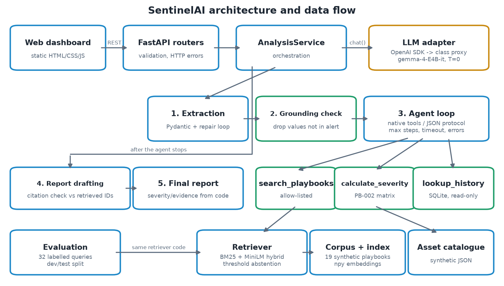

# SentinelAI — Intelligent SOC Incident Triage Copilot

SentinelAI is an LLM-assisted copilot that helps **junior SOC analysts** triage *synthetic* security alerts.
It extracts structured facts from an alert, checks them against the raw text, runs a bounded tool-calling
agent over an original playbook knowledge base, scores severity with a **deterministic, documented matrix**, and
drafts an **evidence-grounded, citation-checked incident report** for human review.

> University capstone prototype. All logs, hosts, users, playbooks and incident history are synthetic and
> fictional ("Kestrel Analytics"). It is an analyst-assistance tool, **not** an autonomous responder: it never
> blocks, isolates, scans or executes anything.

| Capability family (course) | Where |
|---|---|
| Structured output + schema validation | `app/schemas/`, `app/llm/structured.py` (Pydantic, bounded repair) |
| RAG with source citations | `app/rag/`, citation check in `app/services/analysis.py` |
| Retrieval evaluation on a labelled set | `eval/` (32 queries, dev/test split, BM25 baseline vs hybrid) |
| Agent loop with tool calling + stopping condition | `app/agent/loop.py`, `app/agent/tools.py` |
| Served interface (FastAPI REST + dashboard) | `app/api/routes.py`, `web/` |

---

## 1. Problem and users

Tier-1 analysts receive large numbers of alerts with inconsistent formats. Juniors often (a) mis-classify similar
looking alerts (brute force vs. account takeover), (b) guess missing details, and (c) assign severities
inconsistently. SentinelAI targets those three failure modes:

* **Extraction is grounded** — any value the LLM extracts that does not literally appear in the alert is removed and
  reported as a limitation.
* **Guidance is cited** — recommendations must cite playbooks that were actually retrieved in that run; unknown
  citations trigger a repair attempt and, if still invalid, a clear `502` validation error (no fabricated report).
* **Severity is computed, not generated** — `calculate_severity` implements the PB-002 matrix with asset tiers read
  from a catalogue; the model cannot override it.

**Intended users:** junior SOC analysts and instructors/students learning incident triage.

## 2. Features

* **Alert analyzer** — paste/upload JSON or log lines; 12 synthetic samples (brute force, suspicious login,
  privileged account change, malware, encoded PowerShell, command injection, beaconing, exfiltration, DNS tunnelling,
  false positive, insufficient evidence, prompt-injection attempt).
* **RAG knowledge base** — 19 original fictional playbooks (`corpus/raw/`) with stable IDs `PB-001…PB-019`,
  title, version, category, provenance; heading-aware chunking; hybrid BM25 + MiniLM retrieval; threshold abstention.
* **Agent** — native OpenAI-compatible tool calling with automatic fallback to a documented JSON action protocol;
  three allow-listed read-only tools: `search_playbooks`, `calculate_severity`, `lookup_incident_history`;
  max steps, wall-clock timeout, repeated-error stop, duplicate-call refusal, ≤3 calls per turn.
* **Structured report** — `IncidentReport` separates *observed evidence*, *model interpretation* and *suggested next
  steps*; includes limitations, review reasons and `requires_human_review`.
* **Dashboard** — dark SOC-style UI: alert input, severity badge with score breakdown, grounded fields, evidence,
  cited actions (click to open the playbook), agent trace timeline, retrieved passages, playbook search, severity
  calculator, saved analyses, synthetic incident history and the evaluation tables (read from result files).

## 3. Architecture



```
web/ (static UI) ──REST──> app/api (routers: validation, HTTP errors)
                             └─> app/services/analysis.py (orchestration)
                                   ├─ app/llm        LLM adapter (OpenAI SDK -> class proxy, gemma-4-E4B-it, T=0)
                                   ├─ services/grounding.py   drop ungrounded values, detect injection text
                                   ├─ app/agent      bounded loop + allow-listed tools
                                   ├─ services/severity.py    PB-002 deterministic matrix
                                   ├─ app/rag        corpus, chunking, BM25, embeddings, retriever, index
                                   └─ app/repositories  SQLite (analyses, incident history), asset catalogue
eval/   reproducible retrieval experiment + live end-to-end evaluation
```

More detail: [docs/architecture/ARCHITECTURE.md](docs/architecture/ARCHITECTURE.md).

## 4. Technology stack

Python 3.11+ · FastAPI · Pydantic v2 · official `openai` SDK · SQLite · NumPy · scikit-learn (LSA baseline variant)
· sentence-transformers `all-MiniLM-L6-v2` (dense embeddings, optional extra) · pytest · ruff · static HTML/CSS/JS.
The **reasoning/generation model is always `gemma-4-E4B-it` via the class proxy**; the embedding model is a separate,
documented retrieval component.

## 5. Installation

Requires Python ≥ 3.11 and Git.

**Windows PowerShell**
```powershell
git clone https://github.com/ksrddd/sentinel-ai-llm-capstone.git
cd sentinel-ai-llm-capstone
python -m venv .venv
.\.venv\Scripts\Activate.ps1
python -m pip install --upgrade pip
pip install -e ".[dev,neural,report]"
```

**macOS / Linux**
```bash
git clone https://github.com/ksrddd/sentinel-ai-llm-capstone.git
cd sentinel-ai-llm-capstone
python3 -m venv .venv && source .venv/bin/activate
python -m pip install --upgrade pip
pip install -e ".[dev,neural,report]"
```

The `neural` extra installs sentence-transformers (and PyTorch). Without it, the app logs a warning and falls back
to the best non-neural configuration on the dev split (`bm25-section`, threshold 4.220667); `/api/health` reports
`"fallback": true`.

## 6. Environment configuration

```powershell
Copy-Item .env.example .env      # PowerShell
# cp .env.example .env           # bash
```
Edit `.env` and set `OPENAI_API_KEY` and `OPENAI_BASE_URL` to the class proxy values. `.env` is git-ignored; never
commit it. Optional: check proxy features (chat, system role, JSON mode, native tools):
```bash
python -m scripts.check_proxy        # writes eval/results/proxy_compat.json
```

## 7. Data ingestion

```bash
python -m scripts.ingest                     # default: section chunking + sbert embeddings
python -m scripts.ingest --backend lsa       # offline LSA variant
```
Writes `data/index/<chunking>-<backend>/{manifest.json,chunks.json,embeddings.npy}` (no pickle). The server also
builds the index in memory if it is missing. The first sbert run downloads `all-MiniLM-L6-v2` from Hugging Face.

## 8. Start the application

```bash
uvicorn app.main:create_app --factory --port 8000
```
Open <http://localhost:8000>. API docs: <http://localhost:8000/docs>.

Without proxy credentials the dashboard still serves playbook search, the severity calculator, history and
evaluation views; **Analyze** returns a clear `503 LLM proxy is not configured` message.

| Endpoint | Purpose |
|---|---|
| `POST /api/analyze` | full pipeline (LLM) → report, extraction, agent trace, retrieved passages |
| `POST /api/search` | retrieval only (with abstention) |
| `POST /api/severity` | deterministic severity matrix |
| `GET /api/playbooks`, `/api/playbooks/{doc_id}` | corpus and citation viewer |
| `GET /api/history`, `/api/analyses`, `/api/analyses/{id}` | synthetic history and saved analyses |
| `GET /api/eval/summary` | committed evaluation results |
| `GET /api/health` | model, retrieval configuration, LLM configured? |

## 9. Example inputs

```json
{"rule": "AUTH-BF-020", "host": "WS-FIN-114", "user": "j.tan", "src_ip": "203.0.113.45",
 "event_id": 4625, "failed_count": 63, "window_minutes": 8, "successful_logons_after": 0}
```
```text
2026-10-14T07:40:15Z VPN-GW-01 auth[311]: login SUCCESS user=p.wong src=203.0.113.77 mfa=none geo=unknown
```
```text
ALERT rule=7781 severity=unknown message="anomalous behaviour detected"     <- insufficient evidence
```
All samples: `data/synthetic/sample_alerts.json` (IPs are RFC 5737 documentation ranges).

## 10. RAG and agent workflow

1. **Extraction** — Gemma returns JSON validated by `ExtractedIncident` (up to 3 attempts with validator feedback).
2. **Grounding** — values absent from the alert text are dropped; prompt-injection phrases are detected.
3. **Agent** — the model chooses tools. Every call is validated by a Pydantic model with `extra="forbid"`; unknown
   tools are rejected; results return to the model wrapped in `<tool_result>` tags and marked as untrusted data.
   Stops on: final answer · `SENTINEL_AGENT_MAX_STEPS` (6) · timeout (150 s) · 3 consecutive errors · transport error.
4. **Enforcement** — if the agent skipped `search_playbooks`, or called `calculate_severity` with factors that differ
   from the grounded extraction, the orchestrator runs the tool itself and records an `enforced_tool_call` step.
5. **Report** — Gemma drafts summary, interpretation, actions and citations; citations must be a subset of the
   retrieved IDs (bounded repair, else `502`). Severity, evidence, indicators and citation metadata are filled in by
   code, never by the model.

## 11. Evaluation methodology

* **Dataset:** `eval/datasets/retrieval_eval_v1.jsonl` — 32 hand-labelled queries (16 dev / 16 test):
  answerable, ambiguous, similar-looking-but-different-playbook, false-positive, insufficient-evidence,
  policy questions and 4 out-of-domain questions. Each row has `relevant_document_ids`, `expected_incident_type`,
  `expected_severity` (+ the factors, checked against PB-002 by `tests/test_eval_dataset.py`),
  `expected_abstention` and a `notes` justification. A test asserts no query shares a 6-word sequence with the corpus.
* **Metrics:** Recall@3, MRR@5 (primary), Precision@3, Hit@1 — averaged over *answerable* queries;
  abstention accuracy — over *all* queries (abstain iff no relevant document exists).
* **Baseline A:** BM25 over fixed 120-word chunks (naive implementation).
* **Candidates:** BM25 with heading-aware chunks; dense LSA; dense MiniLM; hybrid (α ∈ {0.3, 0.5, 0.7}).
* **Protocol:** thresholds tuned on **dev only**; configuration selected on **dev only** by
  mean(Recall@3, MRR@5); baseline and selection then reported on the **held-out test** split.

Reproduce:
```bash
python -m eval.run_retrieval_eval      # ~1 min on CPU; add --no-sbert to skip the neural backend
python -m scripts.make_figures         # regenerates the charts from the result files
```
Outputs (single source of truth): `eval/results/retrieval_runs.json`, `per_example.csv`,
`selected_config.json`, `retrieval_summary.json`.

## 12. Results (measured, `retrieval_summary.json`, generated 2026-10-16)

Selected on dev: **`hybrid-sbert-section-a0.3`** (α = 0.3 dense / 0.7 lexical, threshold 0.316955).

| Held-out TEST (16 queries, 14 answerable) | Recall@3 | MRR@5 | Precision@3 | Hit@1 | Abstention acc. |
|---|---|---|---|---|---|
| Baseline A: `bm25-fixed` | 0.679 | 0.696 | 0.238 | 0.643 | 0.875 |
| Selected B: `hybrid-sbert-section-a0.3` | **0.750** | **0.729** | **0.262** | 0.643 | 0.875 |

| DEV (used for selection) | Recall@3 | MRR@5 | Abstention acc. |
|---|---|---|---|
| Baseline A | 0.929 | 0.881 | 1.000 |
| Selected B | 0.964 | 0.952 | 1.000 |

Per-query RR@5 on test vs. baseline: **2 wins, 1 loss, 11 ties**. Chunking alone (BM25 fixed → section) also
improved test Recall@3 0.679 → 0.750 and MRR@5 0.696 → 0.750.

**Honest reading.** The improvement is real but small and measured on only 14 answerable test queries, so it is not
statistically strong. The dev→test drop shows the dev split is easier than the test split. Notably
`dense-sbert-fixed` scored best on *test* (R@3 0.964, MRR@5 0.845), but it was **not** selected because selection
used dev only; we report it rather than re-selecting on test. Remaining test failures of the selected configuration:

| Query | Problem | Likely cause |
|---|---|---|
| Q02 SSH spraying on LAB-TEST-07 | PB-004 ranked 5th | hostname token matches the asset catalogue (PB-018) |
| Q04 impossible travel | wrongly abstained | no lexical overlap ("Lagos", "Bangkok") and weak dense score |
| Q20 phishing + credential entry | PB-005 missed | second relevant doc ranked below 3 |
| Q26 "cut … off the network" | PB-016 not in top 5 | vocabulary mismatch with "isolate" |
| Q30 marketing sales figures | not abstained | generic words score just above threshold |

### End-to-end evaluation (live Gemma `gemma-4-E4B-it` via the class proxy, temperature 0)

`python -m eval.run_e2e_eval` sends every labelled alert through the full pipeline (extraction → agent → report).
The first run (r0) exposed systematic errors, so the pipeline was improved in three rounds. Each round is recorded
in [`docs/EXPERIMENT_LOG.md`](docs/EXPERIMENT_LOG.md), and its raw outputs are in `eval/results/rounds/<round>/`.
Before each round, a **new holdout set of 16 alerts** was written and labelled, so every change has one measurement
on data it was not designed from.

The table shows that blind measurement for each round, before → after:

| Round (change) | Blind set | Severity acc. | Relevant citation |
|---|---|---|---|
| r1: explicit confidence/impact definitions; insufficient-evidence search | holdout v2 | 0.462 → **0.615** | 0.750 → **0.812** |
| r2: evidence kind → deterministic confidence; retry search when agent's search abstains | holdout v3 | 0.923 → 0.923 | 0.812 → **0.938** |
| r3: yes/no "malicious outcome confirmed" flag; label-only last-resort search | holdout v4 | 0.615 → **0.846** | 1.000 → 1.000 |

Final configuration (r3) on the original test split (12 cases, 7 with a severity label):

| Metric | Value |
|---|---|
| valid structured output | 1.000 |
| incident type | 1.000 |
| severity | 1.000 |
| citation validity | 1.000 |
| relevant citation | 1.000 |
| undetermined flagged | 1.000 |
| native tool calling | 1.000 |

The test split was 0.571 for severity at r0. Its failures were inspected before r1, so its later numbers are
**not blind**. Use the holdout rows above for an unbiased reading.

* **r2b repeat run.** Re-running r2 on holdout v3 gave identical incident types, severities and severity factors.
  The changes between rounds are therefore not sampling noise.
* **r3 regressed on one set.** On holdout v3 (seen) it lost one severity case and one citation. Pooled over all
  sets, correct severities went from 40/51 (r2) to 43/51 (r3).
* **Remaining errors** are listed at the end of the log. They are mostly impact still rated `suspected` when
  execution is shown, and borderline evidence-kind calls.

## 13. Tests

```bash
pytest                 # offline: 260 tests, mocked LLM, no credentials needed
pytest -m live         # opt-in, requires OPENAI_API_KEY / OPENAI_BASE_URL
ruff check .
```
Covers input validation, schemas, ingestion, doc-ID/citation integrity, retrieval and metrics, severity policy,
tool argument validation, unknown-tool rejection, max-step/timeout/repeated-error termination, malformed LLM output and
repair, fabricated citations, prompt injection in alerts, missing configuration, REST endpoints, path traversal and
security headers. CI (`.github/workflows/ci.yml`) runs lint, offline tests and the retrieval evaluation; live tests
are a manual opt-in workflow input using repository secrets.

## 14. Limitations

* Synthetic corpus of 19 short documents and 32 queries — results do not generalise to real SOC data.
* Test split is small (14 answerable queries); differences of one query move metrics by ~0.07.
* End-to-end sets are small (12-16 alerts, 5-13 with a severity label); one alert moves accuracy by 6-20 points.
* Gemma still rates impact `suspected` on some alerts that show confirmed execution (see docs/EXPERIMENT_LOG.md).
* Grounding is literal substring matching: paraphrased but correct values are dropped (safe but lossy).
* Prompt-injection detection is pattern-based; the real protection is that tools are read-only and allow-listed.
* Abstention uses one global threshold; generic out-of-domain wording can pass it (Q30).
* Single-process SQLite store; no authentication — run locally only.

## 15. Security considerations

No shell/file/network tools; allow-list + `extra="forbid"` argument models; hostname regex; parameterised SQL;
document IDs matched against `^PB-\d{3}$` and served from memory (no path joins); untrusted-data tagging of alerts,
tool results and playbook excerpts; citations validated against retrieved IDs; severity computed in code; secrets only
from environment, never logged or returned (key-like strings are redacted from error messages); `.env.example`
placeholders are detected and rejected; request bodies capped at 64 KiB (413); at most 2 concurrent analyses (429);
strict CSP (relaxed only on `/docs` and `/redoc`)/nosniff/frame-deny/`no-store` on API responses; embedding model
pinned to a Hugging Face commit; all UI rendering via `textContent`. No authentication: bind to localhost only
(uvicorn's default `127.0.0.1`), never `--host 0.0.0.0` on a shared network.

## 16. Demo

* Local demo: follow sections 5–8. Script: [docs/DEMO_SCRIPT.md](docs/DEMO_SCRIPT.md).
* Defense preparation: [docs/DEFENSE_QA.md](docs/DEFENSE_QA.md).
* Report: [docs/report/SentinelAI_Capstone_Report.pdf](docs/report/SentinelAI_Capstone_Report.pdf)
  (rebuild: `python -m scripts.build_report`). Thai executive summary:
  [docs/report/EXECUTIVE_SUMMARY_TH.md](docs/report/EXECUTIVE_SUMMARY_TH.md).
* Demo video / hosted deployment: **not created yet** (manual step).

## 17. Acknowledgements and references

* Course reference application: [Nat-D/kmitl-llm-app-demo](https://github.com/Nat-D/kmitl-llm-app-demo) — general
  ideas reused (thin LLM adapter module, `min_score` retrieval floor, router → service → repository layering,
  retrieval metrics, agent loop shape). No code, corpus or evaluation data was copied.
* Robertson & Zaragoza, *The Probabilistic Relevance Framework: BM25 and Beyond* (2009).
* Reimers & Gurevych, *Sentence-BERT* (2019); model `sentence-transformers/all-MiniLM-L6-v2` (Apache-2.0).
* Deerwester et al., *Indexing by Latent Semantic Analysis* (1990).
* RFC 5737 (IPv4 documentation address ranges) for synthetic IPs.
* Playbooks are original fictional text inspired by general incident-handling concepts; they are not real policies.
